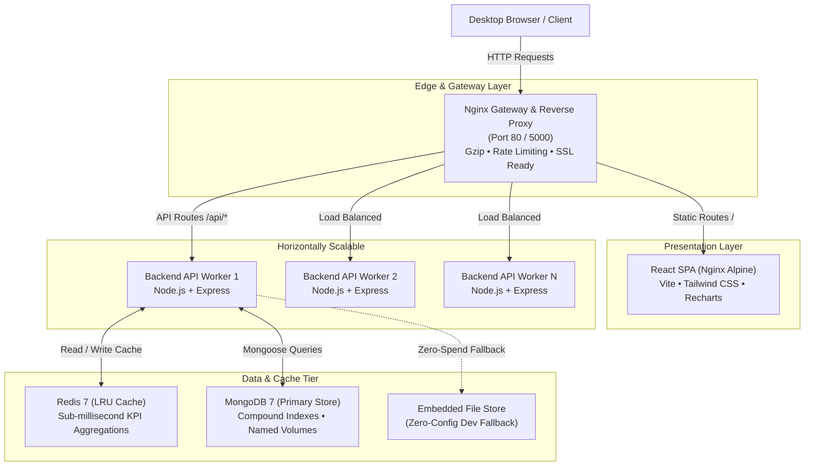
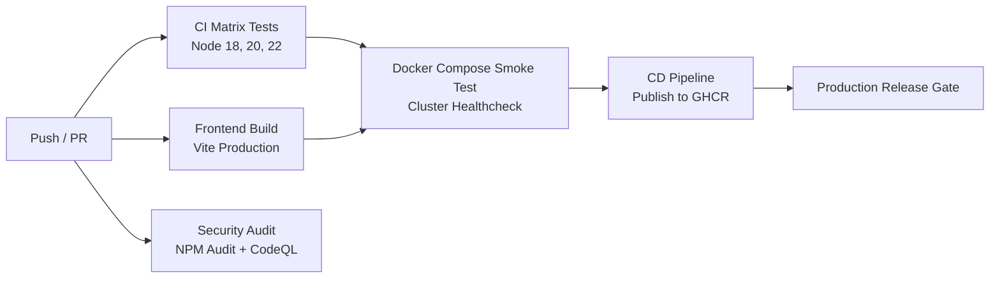

# 📊 Analyst Team KPI Dashboard (MERN Stack)

[](https://github.com/ananya-giri/solvrex-kpi-dashboard/actions/workflows/ci.yml)
[](https://github.com/ananya-giri/solvrex-kpi-dashboard/actions/workflows/cd.yml)
[](https://github.com/ananya-giri/solvrex-kpi-dashboard/actions/workflows/codeql.yml)
[](docker-compose.yml)
[](package.json)
[-blue)](HANDOVER_NOTE.md)

An enterprise-ready, containerized, and horizontally scalable KPI Dashboard engineered for analyst operations: **output, quality, and delivery in one trusted view**. Built strictly to the Zero-Spend Build Specification using the **MERN stack** (MongoDB, Express, React, Node.js) paired with **Redis distributed caching**, **Nginx reverse proxy load balancing**, and **advanced CI/CD automation**.

---

## 🏛️ System Architecture



---

## ⚡ System Design & Scalability Concepts

### 1. High-Throughput Caching Layer (`Redis` + In-Memory Fallback)
- **Problem:** Aggregating thousands of task rows across 8 distinct formulas on every page load or filter adjustment causes high database I/O.
- **Solution:** Implemented distributed caching via `ioredis` with automatic graceful fallback to an in-memory TTL map.
- **Cache Invalidation:** Hot KPI summaries are cached with a configurable TTL (30s–60s) and automatically purged when:
  - Settings targets are modified (`/api/settings/update`).
  - Production tracker sync is executed (`/api/sync/refresh`).
  - New batches or tasks are imported.

### 2. Horizontal Scalability & Load Balancing (`Nginx`)
- Nginx acts as the single edge ingress using the `least_conn` load balancing algorithm.
- Scale API workers seamlessly with zero downtime:
  ```bash
  docker compose up -d --scale backend=3
  ```
- Traffic is automatically distributed across healthy backend instances with upstream keepalive connections.

### 3. Database Indexing Strategy
Compound indexes are applied to the primary MongoDB schemas to guarantee sub-millisecond query performance:
- `tasks`: `{ analyst_id: 1, date_assigned: -1 }` (Analyst view performance)
- `tasks`: `{ status: 1, due_date: 1 }` (Overdue backlog scans)
- `tasks`: `{ vertical: 1, city: 1, sheet_type: 1 }` (Work mix aggregations)
- `tasks`: `{ source_record_id: 1 }` (Unique constraint & fast sync deduplication)
- `qa_checks`: `{ task_id: 1, date_checked: -1 }` (QA sample joins)
- `coverage`: `{ task_id: 1, sheet_type: 1 }` (Fill rate calculations)

### 4. Security Hardening & Rate Limiting
- **Helmet:** HTTP response headers protected against clickjacking, MIME-sniffing, and XSS.
- **Dual Rate Limiting:**
  - Global API: 300 requests/minute per IP.
  - Authentication: 30 attempts/15 minutes per IP to eliminate brute force attacks.
- **Role Isolation:** Strict server-side RBAC middleware. An analyst token attempting to access or export another analyst's individual data is immediately blocked with `HTTP 403 Forbidden`.

### 5. Graceful Shutdown & Zero-Downtime Deployment
- Handlers for `SIGTERM` and `SIGINT` finish inflight requests, close MongoDB/Redis connection pools cleanly, and release system ports.

---

## 📈 The 8 Mandated KPIs — Mathematical Formulas

All KPIs are calculated exclusively in a single backend engine (`backend/services/kpiService.js`) ensuring screen views, drill-down counts, and exports always match:

| # | KPI Name | Implemented Formula | Target (Setting) | Zero-QA / Div-0 Rule |
|---|---|---|---|---|
| **1** | **Tasks / Rows Completed** | `∑ rows_completed` in filtered period | 500 rows / day | Hand-matched to source tracker |
| **2** | **Completion Rate** | `(Rows completed / rows assigned) * 100` | ≥ 90% | Div-0 returns `—` |
| **3** | **Accuracy Rate** | `(Rows verified correct / rows checked in QA sample) * 100` | ≥ 95% | **Zero QA sample displays "Not checked" (never 0% or 100%)** |
| **4** | **Rework Rate** | `(Rows sent back / rows completed) * 100` | ≤ 5% | **No double counting**: reworked row counts once on final delivery |
| **5** | **On-Time Delivery** | `(Tasks delivered on/before due date / tasks due) * 100` | ≥ 95% | Evaluated against assigned `due_date` |
| **6** | **Coverage / Fill Rate** | `(Required fields filled / required fields total) * 100` | ≥ 85% | Computed across phone, email, website, social |
| **7** | **Duplicate Rate** | `(Duplicate rows found / rows completed) * 100` | ≤ 1% | Per sheet type verification |
| **8** | **Pending / Backlog** | Count of assigned tasks not completed and past due date | 0 overdue | **Status badge turns RED if > 0** |

---

## 🔄 Advanced CI/CD Pipelines

Our automated GitHub Actions workflows test, verify, and package the application across multiple environments:



1. **`ci.yml` (Continuous Integration):**
   - **Multi-Node Matrix:** Runs backend tests on Node 18.x, 20.x, and 22.x.
   - **Formula Test Suite:** Verifies all 8 KPI formulas, zero-QA division edge cases, and server security checks.
   - **Frontend Compilation:** Validates that Vite builds asset bundles without warnings or bundle failures.
   - **Docker Smoke Test:** Spins up the multi-container compose cluster (`gateway`, `frontend`, `backend`, `mongodb`, `redis`), probes `/api/health`, and teardowns cleanly.
2. **`cd.yml` (Continuous Delivery):**
   - Builds production OCI images and publishes to GitHub Container Registry (`ghcr.io/ananya-giri/...`).
   - Tags with branch, semantic version, and commit SHA.
3. **`codeql.yml` (Security Scanning):**
   - Scans JavaScript/TypeScript code for vulnerabilities and CWE compliance.

---

## 🐳 Docker Deployment Guide

### Option A: Production Multi-Container Cluster (Recommended)
Spins up Nginx Gateway, React Frontend, Express Backend, MongoDB, and Redis with healthchecks and volume persistence:

```bash
# 1. Build and start the entire cluster in background
docker compose up -d --build

# 2. Check cluster health and running containers
docker compose ps

# 3. Horizontally scale backend API workers
docker compose up -d --scale backend=3

# 4. Access the Dashboard
# Open http://localhost (or http://localhost:5000)
```

To stop the cluster:
```bash
docker compose down
```

### Option B: Local Development with Live Reload
```bash
docker compose -f docker-compose.dev.yml up
```

### Option C: Bare-Metal / Local Node.js Execution
```bash
# 1. Install dependencies
npm install --prefix backend
npm install --prefix frontend

# 2. Build frontend assets
npm run build

# 3. Run full-stack application (Unified on Port 5000)
npm start

# 4. Run automated formula verification tests
npm test
```

---

## 👥 Demo Personas & Test Accounts

| Persona | Role | Email | Password | Default Redirect |
|---|---|---|---|---|
| **Vikram Sethi** | Manager | `manager@company.com` | `password123` | `/team` (Team View) |
| **Rahul Sharma** | Analyst | `rahul@company.com` | `password123` | `/individual` (Individual View) |
| **Priya Patel** | Analyst | `priya@company.com` | `password123` | `/individual` (Individual View) |
| **Sanjay Gupta** | Admin | `admin@company.com` | `password123` | `/settings` (Settings View) |

---

## ⚙️ Environment Variables Reference

| Variable | Default Value | Description |
|---|---|---|
| `PORT` | `5000` | Port for Express backend server |
| `NODE_ENV` | `production` | Execution environment (`production` / `development`) |
| `MONGODB_URI` | `mongodb://mongodb:27017/kpi_dashboard` | Connection string for MongoDB database |
| `REDIS_URL` | `redis://redis:6379` | Connection string for Redis cache |
| `JWT_SECRET` | `zero-spend-kpi-dashboard-production-secret-2026` | Secret key for signing authentication tokens |

---

## 📜 Zero Spend Compliance
- **100% Free & Open Source:** Node.js, Express, React, MongoDB Community, Redis, Nginx, ExcelJS, Recharts.
- **No Paid Tools / Cloud Plans:** No card required, Rs. 0 spent, zero recurring subscriptions.
- Detailed handover documentation and signed-off operational procedures can be reviewed in [HANDOVER_NOTE.md](HANDOVER_NOTE.md).
